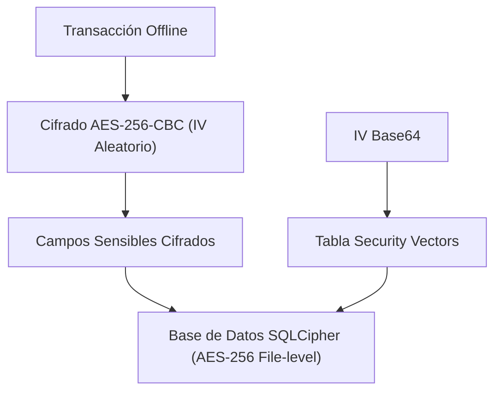

# Post 1: Criptografía y Persistencia Offline en Dispositivos Móviles

**Autor:** Alejandro Barragán Jasso  
**Enfoque:** Tech Lead / Mobile & Embedded Payment Systems Engineer

---

## 📱 Copia para Publicación en LinkedIn

```text
🔐 ¿Cómo almacenar datos financieros de forma segura cuando la terminal pierde conexión a internet?

El modo offline en dispositivos de cobro es una necesidad operativa en zonas remotas, pero introduce riesgos críticos de seguridad si no se aísla la información sensible.

Para cumplir con normativas estrictas y evitar fugas de datos en reposo o al momento de descarte, diseñamos un esquema de triple protección:

1. Cifrado a nivel de base de datos con SQLCipher.
2. Cifrado granular a nivel de campo con AES-256-CBC y vectores de inicialización (IV) únicos por registro.
3. Destrucción segura bajo estándar DoD 5220.22-M con sobrescritura en 3 fases antes de la eliminación física.

Desliza en el documento para ver la arquitectura, el flujo de enrutamiento y cómo prevenimos falsos positivos de red. 👇

#MobileSecurity #Flutter #Cryptography #CleanArchitecture #Fintech #AndroidDev #SQLite
```

---

## 📊 Encuesta para el Primer Comentario

> **Pregunta:** ¿Qué nivel de seguridad consideras prioritario en apps móviles financieras?
> - Opción 1: Cifrado a nivel de archivo (SQLCipher)
> - Opción 2: Cifrado granular por campo (AES-CBC)
> - Opción 3: Detección de root/jailbreak y anti-reverse engineering
> - Opción 4: Borrado seguro de memoria flash (DoD 5220.22-M)

---

## 🏛️ Diagrama de Arquitectura de Seguridad



---

## 💻 Código de Ejemplo
El código ejecutable completo se encuentra en:  
[`examples/01_offline_cryptography/offline_crypto_vault.py`](../examples/01_offline_cryptography/offline_crypto_vault.py)
